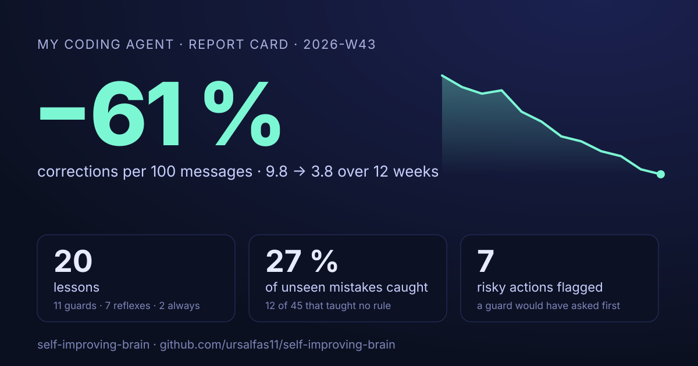
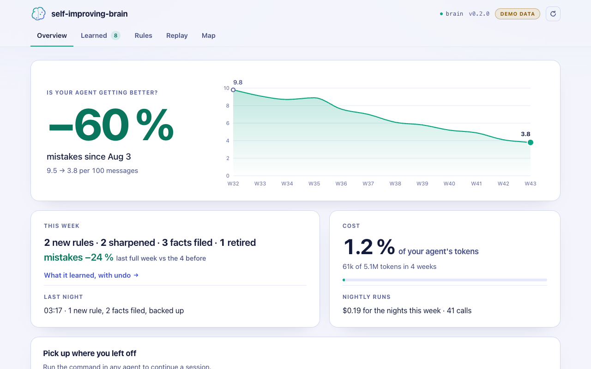

<div align="center">



<br>

<h3>The self-improving memory &amp; second brain for AI coding agents</h3>

<p>
Install it once, then forget it. Every night it turns your corrections into rules<br>
and your decisions into notes, on its own. Your agent makes <b>fewer mistakes every week</b>, and the brain shows you the numbers.
</p>

<p>
<a href="https://github.com/ursalfas11/self-improving-brain/actions/workflows/ci.yml"></a>


<a href="https://github.com/ursalfas11/self-improving-brain/stargazers"></a>
</p>

<p>
<a href="#-quickstart"><b>Quickstart</b></a> ·
<a href="#-how-it-gets-smarter"><b>How it gets smarter</b></a> ·
<a href="#-prove-it"><b>Prove it</b></a> ·
<a href="#-rules"><b>Rules</b></a> ·
<a href="#-works-with-every-agent"><b>Agents</b></a> ·
<a href="docs/architecture.md"><b>Architecture</b></a>
</p>

</div>

<br>

<p align="center">
  
</p>

## 🤯 The problem

You told your agent *"no, never paper over a flaky test with retries"* last Tuesday. Today it adds a retry again.

Agent mistakes rarely come from missing facts. They come from a rule the agent *knew* but didn't apply **at the moment it mattered**. This brain learns the rule from you, brings it back at that moment, and checks whether the mistake comes back.

<table>
<tr>
<td width="33%" valign="top">

### 🌙 Learns on its own
Every night a small model reads the day's sessions through an LLM CLI you already have. What you said in two sessions, or said with *always* or *never*, becomes a rule. Nothing waits for your approval.

</td>
<td width="33%" valign="top">

### ⚡ Fires at the right moment
Prompt words, a tool, a shell command or a path trigger a rule. Where you once stopped the agent, a `guard` makes it **ask you** before `git push --force`, `rm -rf` or `DROP TABLE`.

</td>
<td width="33%" valign="top">

### 📉 Proves it works
`brain` shows your mistakes per 100 messages since the week you installed it, against the weeks before. `brain replay` shows which past corrections today's rules would fire before, counting apart the ones a rule was learned from.

</td>
</tr>
<tr>
<td valign="top">

### ↩️ A veto, not a duty
Every change goes into a journal. `brain review` lists the last two weeks, `brain undo 2` takes one back, and a topic you undid is never learned again.

</td>
<td valign="top">

### 🧠 Knows more every week
Decisions, facts about your projects and pitfalls from your sessions land in the note that owns them. A newer statement replaces the outdated one: one truth per fact.

</td>
<td valign="top">

### 🧹 Cleans up after itself
A rule that keeps getting broken gets sharper, then stricter. A rule that never fired in 60 days retires. At most eight rules are always on.

</td>
</tr>
<tr>
<td valign="top">

### 🪶 Costs almost nothing
The hooks add a few lines at session start, and a rule shows up only when it matches. The nightly model has a hard cap of $0.10 a day. `brain` shows what the brain costs you, measured.

</td>
<td valign="top">

### 🤝 In every agent
Native hooks and a plugin for Claude Code, an MCP server for Cursor, Windsurf, Claude Desktop, VS Code, Gemini CLI and Codex, and instruction files for the rest.

</td>
<td valign="top">

### 🔒 Never behind your back
Rules come only from your own words, never from tool output. A rule an agent wrote stays silent until you trust it. Secrets are blocked on save, on write and at commit.

</td>
</tr>
</table>

## 🚀 Quickstart

```bash
curl -fsSL https://raw.githubusercontent.com/ursalfas11/self-improving-brain/main/install.sh | sh
```

<p align="center">
  
</p>

That is all. Setup asks nothing. It needs git and Python 3.9+ (the `python3` that ships with macOS works), no root and nothing to compile. It reads the sessions you already had: your baseline is there on day one, and the first rules a few minutes later. To learn, it uses the `claude`, `codex` or `ollama` CLI you already have, with your login; no API key is stored anywhere. `brain setup --github` adds a private backup.

**Claude Code plugin**, if you prefer to install from inside Claude Code:

```text
/plugin install self-improving-brain --marketplace ursalfas11/self-improving-brain
```

The first session then tells you to run `brain setup`. Older Claude Code: `/plugin marketplace add ursalfas11/self-improving-brain`, then `/plugin install self-improving-brain@self-improving-brain`.

<details>
<summary>Other ways to install</summary>

```bash
pipx install git+https://github.com/ursalfas11/self-improving-brain && brain setup
# or, from a clone, no install at all:
git clone https://github.com/ursalfas11/self-improving-brain && cd self-improving-brain && ./brain setup
```
`--no-llm` and `--no-schedule` leave out learning and the nightly run. `brain update` updates. `brain uninstall` takes it out of every agent, the schedule and your notes' git hook, removes the `brain` link, its cache and settings, and prints the one command that removes the program (`rm -rf ~/.local/share/self-improving-brain` after the installer). Your notes stay.
</details>

<details>
<summary>What your agent sees at session start</summary>

```text
SELF-IMPROVING-BRAIN memory at ~/brain: look things up with `brain search "<question>"` and `brain read <note> [section]`; keep what will matter later with `brain remember <fact|decision|pitfall|preference> "<one sentence>"`.
LESSONS (apply in every session):
- L-result-first: Lead with the result in a few lines; details only when asked …
- L-verify-before-done: Before saying something works or is done, run it or test it and show the output …
```
</details>

## ☕ Day to day

You do not have to do anything. If you want to look:

```text
$ brain

  🧠  self-improving-brain   ~/brain

  Mistakes     3.8 per 100 messages · −60 % since Aug 3
  This week    2 new rules · 2 sharpened · 3 facts filed · 1 retired
  Cost         1.2 % of your agent's tokens · $0.19 for the nights
  Last run     03:17 · 1 new rule, 2 facts filed, backed up

  23 rules (3 always, 5 guards) · 11 notes · 412 sessions read
```

```text
$ brain review

Learned in the last 14 days. Take anything back with brain undo <n>.

   1  Oct 30  new rule        Run database migrations against a copy of the database first, and show the result …
                              you said it in 2 sessions: “not on the real db first, take a copy”
   2  Oct 30  updated         acme-api › The staging database moved to eu-west-2 in October.
                              newer than “The staging database runs in eu-central-1.”
   3  Oct 28  reflex → guard  Do not commit or push straight to main or master - create a branch and open a pull …
                              it came back after it was sharpened: “why is this on main again”

$ brain undo 3
✓ L-git-branch-first is reflex again
```

Once a week, the first session shows one line, so you know without looking:

```text
🧠 This week: 2 new rules · 2 sharpened · 3 facts filed · 1 retired · mistakes −24 % · brain cost 1.2 % of your tokens — `brain review` shows it, undo anything.
```

## 🔁 How it gets smarter

<p align="center">
  
</p>

The model itself never learns. What improves is **what your agent is told, and when**, and the brain measures the effect:

<p align="center">
  
</p>

<details>
<summary><b>Every signal it learns from</b></summary>

<br>

| Signal | What the brain does |
|---|---|
| You corrected the agent, or rejected a tool call | 📝 noted on the spot, without an LLM. At night the small model decides: a lasting rule, a fact, or a one-off |
| You said it in two sessions, or said *always* / *never* | ✅ it becomes a rule, in the note that owns the topic |
| A decision, a fact or a pitfall came up in a session | 🗂️ filed into its note; a newer statement replaces the outdated one |
| A rule was shown and the mistake came back anyway | 🔧 the rule is sharpened; when it comes back again, the rule becomes `always`, or a `guard` if you had stopped a tool call |
| The agent wrote what a rule's `check:` forbids | 🚨 flagged on the spot, counted per week |
| A rule never fired in 60 days | 💤 retired; `brain undo` brings it back |
| Recall offered a note, and the agent opened it | ✅ hit: the note gains weight |
| Recall offered a note, and the agent ignored it | the note loses weight; if precision drops, the **recall threshold rises by itself** |
| The agent opened a note recall *didn't* offer | the prompt's words get attached to that note, so it is found next time |

</details>

<details>
<summary><b>Under the hood: three layers, all local</b></summary>

<br>

1. **Inbox.** Anything new becomes one self-contained claim first (`fact`, `decision`, `pitfall`, `preference`), from the nightly run or from `brain remember`. It is secret-scanned and de-duplicated on entry.
2. **Wiki.** Markdown notes with a tiny frontmatter, hubs and `[[wikilinks]]`, kept to *one truth per fact*. The nightly run files each claim: it appends it, replaces the outdated line it contradicts, or starts a note. A change that fails lint or the secret scan is rolled back, and every change lands in the journal.
3. **Interface.** A CLI your agent calls instead of `cat`-ing whole files. `brain search` returns the 3–5 best *sections* with dates. `brain read note "section"` returns an outline with token counts, or exactly one section.

Recall combines **BM25 over sections**, **learned terms** and **graph spreading** over your `[[links]]`. It is explainable and has zero dependencies. The parsed vault is cached and rebuilt only when a note changes, so the hooks stay fast:

| Hook (600-note vault, Apple M5, incl. Python start) | Time |
|---|---|
| session start | ~70 ms |
| every prompt (recall + word rules) | ~80 ms |
| every tool call (reflexes, guards, secret block) | ~60 ms |

The details are in [docs/architecture.md](docs/architecture.md).
</details>

## 🔬 Prove it

Most memory tools store things and hope. This one shows its work, on your own history:

```text
$ brain replay                                    # example output
REPLAY · 127 sessions · last 30 days · 24 active rules
  Today's rules would fire before 31 of 64 past corrections, 7 of them by asking you first.
  19 of these taught a rule, so they match by design; of the 45 others, the rules catch 12 (27 %).
  missed 9 (a rule exists, its triggers did not fire) · uncovered 24 (no rule yet)
RULES
  L-flaky-tests-root                       caught   6 · missed   2  → widen: words race, timeout
```

Nothing leaves your machine, and no LLM is involved.

**Does it notice when you correct it?** Measured on 250 hand-labelled replies in six languages, tuned on one half and tested on the other. On the test half, 93 % of what it flags is a real correction, and it finds 86 % of the ones that should become a rule. Then the nightly judge threw out every false alarm and kept every lasting correction, for one cent. The data, the method and the numbers per language are in [eval/](eval/README.md).

<p align="center">
  
</p>

`brain report --public` draws this card from your numbers: no notes, no rules, no quotes, no paths, so you can post it. `brain report --badge` makes a small README badge. (The card above uses the example data of `brain ui --demo`.)

**Brain-Bench** goes one step further, with real agent runs: eight small repos that tempt an agent into a known mistake (a retry on a flaky test, skipping a red test, a hard-coded key, a bare `except`, force-pushing over a colleague, `rm -rf`, committing `.env`, a mutable default). [`bench/run.py`](bench/README.md) runs `claude -p` on each, with and without the brain, fully isolated, and scores what the agent ran and left behind. Without `--run` it only prints the plan and a cost ceiling, so you decide what your quota pays for.

## 🖥️ See it

```bash
brain ui          # your brain in the browser: progress, what it learned (with undo), rules, replay, the map
brain ui --demo   # the same with example data
```

<p align="center">
  
</p>

The page is served on 127.0.0.1 only and answers only requests that carry the random token from the link `brain ui` prints, so no web page you visit can read your vault or click *undo* for you.

## 🎯 Rules

A rule is a callout **in the note that owns the topic**, so there is no separate rules file that drifts.

```markdown
> [!lesson]- L-fix-flaky-tests-root
> rule: Fix flaky tests at the root (race, shared state); never paper over them with retries or sleeps.
> mechanism: reflex
> words: flaky, is flaky, retry
> paths: (^|/)tests?/|test_
> check: @retry\b|pytest\.mark\.flaky
> since: 2026-10-28
```

| Mechanism | Effect |
|---|---|
| `always` | in every session start (eight at most) |
| `reflex` | once per session when a trigger matches: the normal case |
| `guard` | the tool call needs your OK: force-push, `rm -rf`, deploys. The brain only makes a guard where you once stopped a tool call. In headless runs `BRAIN_GUARD=deny` refuses instead |

**Triggers:** `words` (two hits, or one exact phrase) · `tools` (a name suffix: `deploy` matches any `mcp__*__deploy`) · `commands` (a regex on the shell command) · `paths` (a regex on file paths). **`check:`** is a regex on what the agent writes or runs: a match on a reflex is a violation the brain counts on its own; on a guard it asks before the write happens.

**Trust.** A rule is plain text, so anything that can write a file could plant one, including an agent that read a poisoned web page. So the nightly run learns only from what *you* typed, never from tool output, and never adopts a rule with a link or a secret in it. A rule that appears during an agent's tool call stays silent until you trust it; `brain review` lists those. Undo, trust and config are commands the agent has to ask you for.

## 🤝 Works with every agent

| Agent | Integration | You get |
|---|---|---|
|  | **native hooks** or the **plugin**, + `/brain` | everything: recall, reflexes, guards, checks, secret block, your exact words across compaction, the weekly line |
|  | **MCP server**, connected by `brain setup` | `brain_context`, `brain_check`, `brain_correction`, `brain_search`, `brain_handoff` and more; what an agent reports never becomes a rule on its own |
|  | `~/.codex/AGENTS.md`, MCP, transcript learning | context, rules, guards via `brain check`, plus mistakes learned from `~/.codex/sessions` |
|  | `~/.gemini/GEMINI.md` + MCP | context, search, remember, rules, guards |
|  | `brain install agents` → the project's `AGENTS.md`, or `brain mcp config` | context, search, remember, rules |
| anything with a shell | `brain install print` | paste the block wherever your agent reads instructions |

## 🌙 Every night, on your laptop

At 03:17 (launchd, cron or Task Scheduler; a night the laptop slept through runs at your next session), the brain runs one pass and backs itself up to your **private** repo:

```text
pull → read sessions → weigh corrections* → adopt rules → extract knowledge* → file it* → clean up → replay → tune recall → INDEX.md → lint → git sync
```

\*These steps use the LLM CLI that setup found, under a hard daily budget: `llm_budget_usd` 0.10 and `llm_max_calls` 40. When the budget is used up, the rest waits for the next night. The brain never holds an API key. Another CLI: `brain config llm_cmd "codex exec -"` or `"ollama run llama3.1"`.

<details>
<summary><b>📋 Commands</b></summary>

<br>

```text
brain              how it is doing
brain review       what it learned lately, with undo
brain undo <n>     take one change back
brain ui           the whole brain in your browser
brain setup        install: asks nothing (--github adds a private backup)

brain doctor       check the installation
brain update       update self-improving-brain
brain uninstall    take it out of every agent again (your notes stay)
```

Your agent uses a few more (`search`, `read`, `remember`, `check`, `resume`, `handoff`); `brain help all` lists everything.

</details>

<details>
<summary><b>🗂️ Your vault</b></summary>

<br>

```text
~/brain/
├── INDEX.md          generated map: one line per note
├── 00-hubs/          entry points, one per topic, carry the current state
├── 10-projects/      things with an end, and one note per repo
├── 20-areas/         lasting knowledge: decisions, how-tos, pitfalls, preferences
├── 30-resources/     references and sources
├── 90-entities/      short stubs for systems, tools, people
└── .brain/           inbox, journal, events, trust ledger (versioned) · state (this machine only)
```

Open it in Obsidian and you get the graph for free: hubs as cluster centres, notes around them.

</details>

## 🆚 Compared to the usual

| | `CLAUDE.md` / `AGENTS.md` by hand | typical memory servers | **self-improving-brain** |
|---|:-:|:-:|:-:|
| Learns from your corrections, on its own | ✗ | rarely | ✅ |
| Keeps one truth per fact (newer replaces older) | by hand | varies | ✅ |
| Injects a rule *at the moment* it matters | ✗ | on request | ✅ |
| Can stop an irreversible action | ✗ | ✗ | ✅ |
| Every change it makes can be undone | – | varies | ✅ |
| Shows whether your agent's mistakes go down | ✗ | ✗ | ✅ |
| A planted rule stays silent until you trust it | ✗ | ✗ | ✅ |
| Context cost per session | grows forever | tool schemas | **a few lines** (hooks) |
| Runs on | – | a server / cloud | **your laptop** |
| Format | one big file | a database | **Markdown + links** |

## ❓ FAQ

<details>
<summary><b>Does the model itself learn?</b></summary>

No, and nothing running on your laptop can do that. What improves is *what the agent is told, and when*. You can see the improvement: `brain` shows your mistakes per 100 messages against the weeks before you installed it, and `brain replay` shows which past corrections your current rules would fire before.
</details>

<details>
<summary><b>What does it cost?</b></summary>

In your sessions: a few lines at session start (where the memory is, your always-on rules, eight at most), and a rule only when it matches. `brain` shows the brain's measured share of your agent's tokens. At night: a small model through the CLI you already use (Haiku with your Claude login, by default), capped at $0.10 and 40 calls a day; `brain` shows what the nights cost this week.
</details>

<details>
<summary><b>What if it learns something wrong?</b></summary>

`brain undo <n>`. An undone rule retires and its topic is blocked, so it is not learned again. An undone fact leaves its note again, and an undone update brings back the old text. Once a week your agent's first session tells you what is new, so nothing piles up unseen.
</details>

<details>
<summary><b>How accurate is the mistake detection?</b></summary>

Measured, in [eval/](eval/README.md): 250 hand-labelled replies in English, German, Spanish, French, Portuguese and Italian, half of them used to tune the patterns, half kept back for the test. On the test half, 93 % of the flagged replies were real corrections or preferences; it found 86 % of the lasting ones and 69 % of all corrections. The hard cases are built in: "no" as the answer to the agent's own question, "oops, I meant the other file", "why a set? just curious". The nightly judge then threw out all four false alarms and kept all 37 lasting corrections. A rule still needs two sessions, or your *always* or *never*, before it is adopted.
</details>

<details>
<summary><b>What does "caught" in replay mean?</b></summary>

A rule about that mistake (its words, command or check match what happened) would have fired before the agent made it: in the prompt that started the turn, or at a tool call before your correction. It does not claim the agent would then have listened; that is what the weekly curve (did the mistake come back after the rule was shown?) and Brain-Bench measure.
</details>

<details>
<summary><b>CLI or MCP server?</b></summary>

Both. In Claude Code the brain uses hooks and a CLI: the hooks add a few lines at session start and fire rules only when they match, while MCP tool schemas would cost tokens in every request. Clients without hooks get the MCP server, whose instructions tell the agent to call `brain_context` first and `brain_check` before irreversible commands.
</details>

<details>
<summary><b>Could someone plant a rule in my brain?</b></summary>

That is the risk we designed against. The nightly run turns only your own messages into rules: never tool output, never what an agent reports, and never text with a link or a secret in it. A rule that appears or changes during an agent's tool call is recorded as pending in the trust ledger and never reaches the agent until you trust it. Undo, trust and config are commands the agent cannot run without asking you, and writes into `.brain/` are refused. `trust_mode strict` goes further: only rules the brain wrote itself count.
</details>

<details>
<summary><b>Why no embeddings?</b></summary>

BM25 + learned terms + the link graph is fast, explainable and has zero dependencies. The learned terms close exactly the vocabulary gaps that embeddings are usually brought in for. A pluggable, still-local embedding scorer is on the roadmap.
</details>

<details>
<summary><b>Can I use my existing notes?</b></summary>

Yes: `brain setup --vault ~/notes`. It adds `.brain/`, a generated `INDEX.md` and a few starter notes, and never overwrites an existing file. That includes your own `INDEX.md` and git pre-commit hook. Edits to existing notes only append text, replace text that went out of date, and set the `updated:` line; the rest of your frontmatter stays byte-for-byte.
</details>

<details>
<summary><b>What if my laptop dies? Multiple machines?</b></summary>

`brain setup --github` creates a **private** GitHub repo for your brain (with the `gh` CLI); any other private remote works with one git command. The nightly run commits, pulls and pushes, and it refuses to push to a repo that turned out to be public. On a new machine: clone your brain repo, then `brain setup --vault <that folder>`. Each machine writes its own file for everything the brain keeps (drafts, inbox, trust, journal, events) and starts each night from what the others pushed, so every laptop learns from all the others and a rule is learned once. Only your notes are shared files: if two machines change the same note on the same night, the sync stops and `brain` tells you, instead of guessing.
</details>

## 🗺️ Roadmap

- [x] learns on its own every night, with undo instead of approval
- [x] MCP server for shell-less clients
- [x] replay past sessions against today's rules
- [ ] `brain learn <repo>`: a codebase's conventions, learned from its history
- [ ] Brain-Bench results across models, published in `bench/results`
- [ ] native hooks for Codex CLI and Gemini CLI
- [ ] transcript parsers for Cursor, Aider, Grok CLI
- [ ] pluggable local embedding scorer

## 💜 Contributing

Issues and PRs are very welcome, above all adapters for more agents, transcript parsers and Brain-Bench tasks. Start with [CONTRIBUTING.md](CONTRIBUTING.md) and [docs/architecture.md](docs/architecture.md). To run the tests: `python3 -m unittest discover -s tests`. The README images are built by `python3 docs/assets/src/build.py`.

<div align="center">

<br>

**If this brain saved you from repeating a correction, a ⭐ helps other people find it.**

<a href="https://star-history.com/#ursalfas11/self-improving-brain&Date">
  
</a>

<sub>MIT licensed · built for agents that should get better, not just bigger</sub>

</div>
